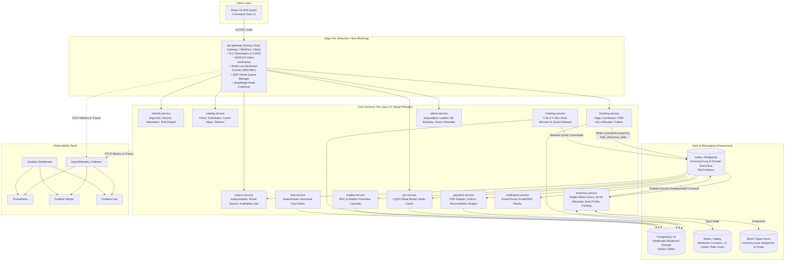
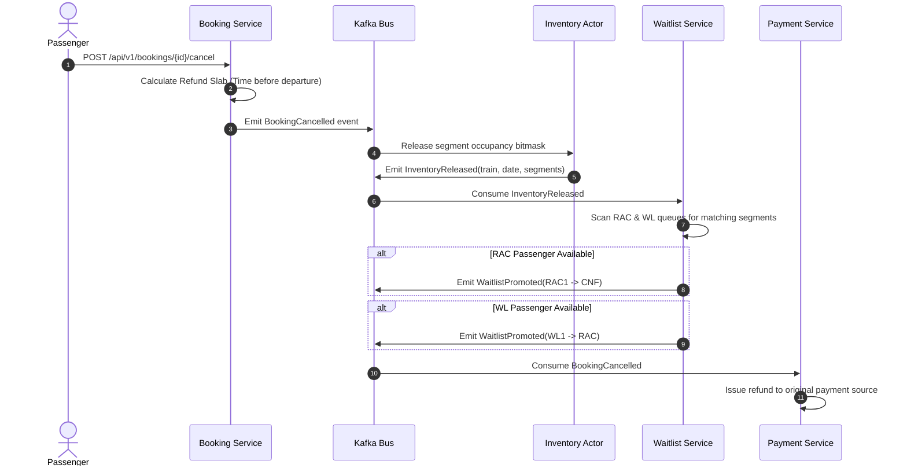

# 03. High-Level Design (HLD)

---

## 1. System Context (C4 Level 1)

```mermaid
flowchart TD
    User["Passenger / Mobile & Web Client"]
    Agent["Authorized Travel Agent"]
    Admin["IRCTC / SRE Operations"]

    subgraph RailFlowSystem["RailFlow Reservation Control Plane"]
        EdgeGate["RailFlow Edge & Admission Gateway"]
        CoreEngine["RailFlow Core Microservices Tier"]
        DataTier["Event Log & Materialized Storage"]
    end

    PSP["Payment Service Provider (Mock PSP)"]
    Aadhaar["UIDAI Identity Provider (Mock Attestation)"]

    User -->|Search, Intent, Book (HTTPS/SSE)| EdgeGate
    Agent -->|Agent Bookings (Subject to Lockout)| EdgeGate
    Admin -->|SRE Operations, Kill Switches, Simulator| EdgeGate

    EdgeGate --> CoreEngine
    CoreEngine --> DataTier
    CoreEngine <-->|Process Payments / Webhooks| PSP
    CoreEngine <-->|Aadhaar OTP & Attestation Check| Aadhaar
```

---

## 2. Container Architecture (C4 Level 2)



---

## 3. The Seven Defining Architecture Decisions (ADR Summary)

1. **ADR-0001: Partition the World by `(train_id, journey_date)`**
   - Write set never spans partitions. Zero distributed transactions across booking instances. Single-writer thread per partition achieves zero-lock concurrency.
2. **ADR-0002: In-Memory Deterministic Replicated State Machine**
   - Full 60-day network inventory is $4.8\text{ GB}$. Evaluated in memory as a pure fold over Kafka log. PostgreSQL is solely a durable projection.
3. **ADR-0003: Edge Admission Control via Atomic Token Decrement**
   - Gateway executes Redis `DECRBY` on open quotas with $4\times$ overshoot factor. 99.9% of Tatkal burst rejected in $<5\text{ ms}$ with `409 SOLD_OUT`.
4. **ADR-0004: CQRS Read Model with Explicit Bounded-Staleness Contract**
   - Reads served from Caffeine L1 and Redis L2 with metadata headers (`as_of`, `staleness_ms`). If staleness $>1,000\text{ ms}$, response degrades gracefully.
5. **ADR-0005: 3-Phase Saga + Outbox + Orphan Reaper**
   - `HOLD` $\to$ `PAY` $\to$ `CONFIRM`. Outbox table ensures atomic message publishing. Background reaper auto-refunds stranded payments within 15 minutes.
6. **ADR-0006: Verifiable Random Fair Lottery During Tatkal Burst**
   - Intended requests in $[T+0, T+2000\text{ms}]$ are batched and ordered by VRF using a pre-committed cryptographic seed $H(\text{seed})$. Network latency advantage is eliminated.
7. **ADR-0007: Java 21 Virtual Threads for Business Tier; Reactive Only at Gateway**
   - Virtual threads handle blocking I/O and relational calls with high throughput. Netty/WebFlux is isolated at the API gateway for 1M long-lived SSE connections.

---

## 4. End-to-End Critical Flows

### 4.1 Tatkal Booking: End to End with Latency Budget

```mermaid
sequenceDiagram
    autonumber
    actor Client as Passenger Browser
    participant GW as API Gateway (Netty)
    participant RD as Redis Cluster
    participant K as Kafka Command Log
    participant INV as Inventory Actor
    participant BK as Booking Service
    participant PSP as Mock PSP
    participant DB as PostgreSQL

    Note over Client, GW: T-5 min: Client registers pre-signed intent token (Ed25519)
    Client->>GW: POST /api/v1/bookings (Intent Token, 180 B) [T+0ms]
    GW->>GW: Verify Ed25519 signature & device attestation [T+2ms]
    GW->>RD: Atomic DECRBY tatkal:{train}:{date}:{class} [T+4ms]
    
    alt Admission Counter < 0
        GW-->>Client: 409 SOLD_OUT (Alternatives Attached) [<5ms]
    else Admitted
        GW-->>Client: 202 QUEUED (Virtual Queue SSE stream) [T+5ms]
        Note over GW, K: Window closes at T+2000ms; Seed revealed; VRF shuffle
        GW->>K: Produce BookingRequested (in lottery order) [T+2002ms]
    end

    K->>INV: Consume command sequentially for (train, date) [T+2005ms]
    INV->>INV: 64-bit Segment Bitmask Exact Check (1.2 µs)
    INV->>INV: Best-Fit Bin-Packing Berth Selection (3.0 µs)
    INV->>K: Emit BerthHeld event [T+2010ms]

    K->>BK: Consume BerthHeld [T+2015ms]
    BK->>DB: Persist HELD booking + lease PNR (HiLo block) [T+2035ms]
    BK-->>Client: Push via SSE: 201 HELD + PaymentIntent [T+2045ms]

    Note over Client, PSP: User proceeds to pay within 600s Hold TTL
    Client->>PSP: Submit Payment (Idempotency-Key: bk_12951)
    PSP-->>BK: Webhook / Callback: PaymentCaptured
    BK->>DB: Update Status = CONFIRMED + Write Outbox
    BK->>K: Emit BookingConfirmed
    K->>INV: Finalize Berth Confirmation
    BK-->>Client: SSE Push: Confirmed Ticket with Coach & Berth!
```

### 4.2 Cancellation & Waitlist Promotion Cascade



---

## 5. Degradation Ladder (Graceful Degradation Policy)

| Level | Condition / Trigger | Automated Mitigation Action | End-User Experience |
|---|---|---|---|
| **L0** | Steady state: Normal operation | All services operating with full fidelity | Real-time graphs, full calendar, instant updates |
| **L1** | Booking $p99 > 500\text{ ms}$ | Disable flexi-fare previews; reduce availability calendar from 7 to 3 days | Minor cosmetic reduction in non-essential UI widgets |
| **L2** | Projection lag $> 2,000\text{ ms}$ | Serve availability with `degraded` flag; disable alternate train suggestions | Clear banner: *"High demand. Showing cached availability as of 2s ago"* |
| **L3** | Booking error rate $> 2\%$ | Cut admission overshoot factor from $4\times$ to $2\times$; extend lottery window to $4\text{ s}$ | Higher edge rejection rate; lower downstream error rates |
| **L4** | Kafka ISR $< 2$ | Reject all mutation attempts; read endpoints remain fully cached | Banner: *"Booking temporarily paused for safety. Search and PNR status live"* |
| **L5** | Catastrophic database failure | Route PNR and search lookups to read replicas; static edge maintenance page | Read-only mode for existing reservations |

> **Architectural Law**: Never degrade correctness. Degrade features, freshness, and throughput—strictly in that order.
