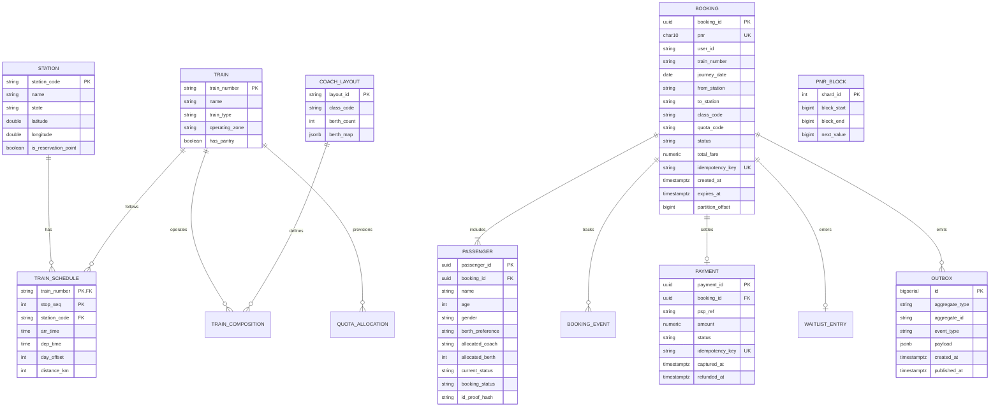

# 05. Data Model, Partitioning & Relational Schema

---

## 1. Entity-Relationship Diagram (ERD)



---

## 2. Partitioning Architecture

The `booking` table experiences high write-volume and natural lifecycle drop-off. It is partitioned using a composite strategy:

```sql
CREATE TABLE booking (
    booking_id UUID NOT NULL,
    pnr CHAR(10) NOT NULL,
    user_id VARCHAR(64) NOT NULL,
    train_number VARCHAR(10) NOT NULL,
    journey_date DATE NOT NULL,
    from_station VARCHAR(5) NOT NULL,
    to_station VARCHAR(5) NOT NULL,
    class_code VARCHAR(4) NOT NULL,
    quota_code VARCHAR(4) NOT NULL,
    status VARCHAR(20) NOT NULL,
    total_fare NUMERIC(10,2) NOT NULL,
    idempotency_key VARCHAR(128) NOT NULL,
    created_at TIMESTAMPTZ NOT NULL DEFAULT NOW(),
    expires_at TIMESTAMPTZ NOT NULL,
    partition_offset BIGINT NOT NULL,
    PRIMARY KEY (journey_date, train_number, booking_id)
) PARTITION BY RANGE (journey_date);

-- Subpartitioning by train_number hash spreads hot festival trains across disk drives
CREATE TABLE booking_2026_10_21 PARTITION OF booking
    FOR VALUES FROM ('2026-10-21') TO ('2026-10-22')
    PARTITION BY HASH (train_number);
```

### Partition Lifecycle
- **Day $T-60$**: Partition created automatically via scheduled cron job.
- **Day $T$**: Train departs; chart finalized.
- **Day $T+7$**: Operational grace period ends. Partition dumped to compressed Parquet on S3/MinIO and dropped from PostgreSQL hot storage, instantly reclaiming tablespace with zero row deletion overhead.

---

## 3. Access Patterns & Query Execution Plans

| Access Pattern | Target Latency | Query Shape | Index Structure | Plan Verification |
|---|---|---|---|---|
| **P1: PNR Status Lookup** | $< 10\text{ ms}$ | `SELECT * FROM pnr_projection WHERE pnr = ?` | Redis Key + B-Tree on `pnr` | Index-Only Scan |
| **P2: Idempotent Submission** | $< 5\text{ ms}$ | `SELECT status, booking_id FROM booking WHERE idempotency_key = ?` | Unique B-Tree `idx_booking_idemp` | Unique Index Scan |
| **P3: Active Train Bookings** | $< 15\text{ ms}$ | `SELECT * FROM booking WHERE journey_date = ? AND train_number = ?` | Composite PK on `(journey_date, train_number)` | Partition Pruned Range Scan |
| **P4: Outbox Relaying** | $< 20\text{ ms}$ | `SELECT * FROM outbox WHERE published_at IS NULL ORDER BY id LIMIT 100` | Partial Index `WHERE published_at IS NULL` | Index Scan on partial |
| **P5: Expired Hold Sweep** | $< 25\text{ ms}$ | `SELECT * FROM booking WHERE status = 'HELD' AND expires_at < NOW()` | Partial B-Tree `idx_held_expires` | Index Scan on partial |

---

## 4. PNR Generation: Contention-Free HiLo + Feistel Obfuscation

Generating sequential 10-digit PNRs creates database write bottlenecks and reveals business booking volume to eavesdroppers. RailFlow employs a **two-tier generator**:

1. **HiLo Memory Block Allocator**:
   Each `booking-service` pod acquires a lease of 100,000 sequence IDs from `pnr_block` using atomic DB row increments (`UPDATE pnr_block SET next_value = next_value + 100000`). Within that block, numbers are served from memory in $< 50\text{ ns}$ with zero database contention.

2. **Feistel Permutation Scramble**:
   To prevent sequential enumeration while preserving a strict 10-digit numerical representation, sequence IDs pass through a 4-round Feistel cipher with a fixed secret permutation key:
   $$\text{PNR} = \text{FeistelPermute}(\text{rawSequenceId})$$
   The output is completely non-sequential, pseudorandom, passes Luhn check requirements, and is uniquely reversible.

---

## 5. Security & PII Protection
- **No Raw Government IDs**: Aadhaar/PAN cards are never stored in plaintext. RailFlow hashes identities with a salt and Pepper:
  $$\text{id\_proof\_hash} = \text{HMAC-SHA256}(\text{aadhaarNumber}, \text{APP\_PEPPER})$$
- Only the last 4 digits (e.g., `XXXX-XXXX-1234`) are retained for conductor ticket inspection.
- Passenger names, ages, and contact details are encrypted at rest using AES-GCM envelope encryption.
